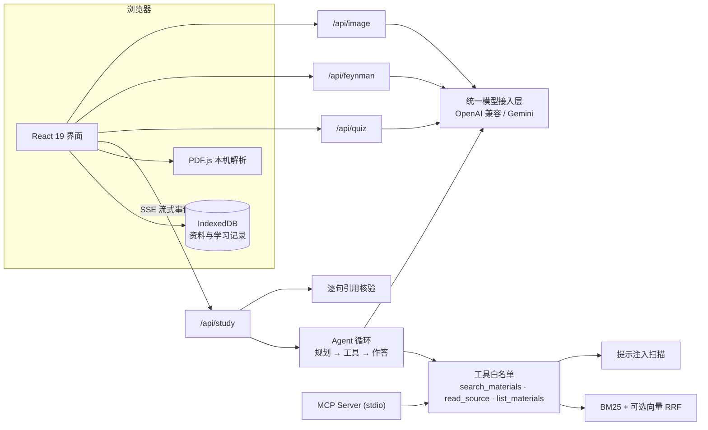

# 知序 ZHIXU

让知识有据可循，让学习循序向前。

2026 第九届传智杯 AI WEB 网页开发挑战赛 · 研究生组 · 省赛作品。方向：AI 教育与学习平台 + RAG 知识问答。

## 作品简介

面向拥有课程讲义、阅读资料和笔记的学习者，把“读过”变成“有证据地理解、讲得出来、记得住”：

1. **导入资料**：PDF / Markdown / TXT / 粘贴笔记 / 图片文字识别，本机解析，保留页码与字符位置。
2. **带着问题探索**：AI Agent 自主决定检索什么、读哪段原文，逐字流式作答；每句结论带可点击引用，并在本地逐句核验引用支持度；支持连续追问。
3. **检验理解**：AI 依据原文出理解题，每道题必须逐字引用原文，引用对不上的题自动淘汰。
4. **用自己的话讲一遍**（费曼学习法）：AI 对照原文指出讲到了什么、漏了什么、哪里理解错了。
5. **间隔复习**：错题次日复习，复述达标后按 1 → 3 → 7 → 14 → 30 天逐步巩固。

所有 AI 功能都有不依赖模型的本地兜底（BM25 原文检索、规则练习、规则复述估算），未配置密钥也能完整体验流程。

## AI 能力一览

| 能力 | 实现要点 | 代码 |
|---|---|---|
| 统一模型接入 | OpenAI 兼容协议（智谱 GLM、DeepSeek、通义、Kimi、硅基流动、本地 Ollama）+ Gemini；流式、工具调用、JSON 输出、视觉、向量统一封装，厂商差异自动降级 | `lib/server/llm.ts` |
| Agent 工作流 | 最多 5 轮“规划 → 工具调用 → 观察 → 作答”；首轮强制检索，模型跳过工具时系统代为检索后重答；每轮最多 4 次调用 | `lib/server/agent.ts` |
| Function Calling / MCP | 3 个只读工具一处定义，同时供模型 Function Calling 和 MCP Server 使用；白名单外的工具调用被拦截 | `lib/tools.ts`、`scripts/mcp-server.ts` |
| RAG | 保留页码的结构化分块、中文二元组 BM25、可选向量检索 + RRF 融合；稳定引用编号 | `lib/retrieval.ts` |
| 流式交互与思考可视化 | SSE 逐 token 输出（按帧合并渲染），实时展示阶段进度、工具调用轨迹、已找到的证据、模型推理过程 | `app/components/question-view.tsx` |
| AI 安全与可控 | 资料提示注入扫描与隔离标注、学习者输入隔离、逐句引用核验、引用编号校验、证据不足拒答、出题与评估结果的原文逐字校验 | `lib/safety.ts`、`lib/learning.ts` |
| 多模态 | 图片文字识别（视觉模型）+ 人工核对后入库；浏览器语音输入（提问与复述）和语音朗读 | `app/api/image`、`workspace.tsx` |
| AI 出题 | 结构化 JSON；薄弱主题优先；题目必须引用原文并通过校验，不足部分由规则题补齐 | `app/api/quiz` |
| 费曼复述评估 | 准确性 40 / 完整性 30 / 理解深度 30 的评分规则；只展示能在原文中找到的引用；结果驱动间隔复习 | `app/api/feynman` |

## 系统架构



- 前端：React 19 + TypeScript，Vinext（Next.js App Router 兼容）+ Vite 8，Context 集中管理状态。
- 服务端：Cloudflare Worker 运行 API 路由；资料随请求发送、不在服务端持久保存。
- 存储：资料、问答、练习与复习记录保存在浏览器 IndexedDB，可导出 / 导入备份（导入时用 zod 完整校验）。

## 快速开始

需要 Node.js ≥ 22.13、npm、Git。

```powershell
npm ci --include=dev --include=optional
npm run dev
```

打开 http://127.0.0.1:5173 。无需密钥即可体验原文检索、规则练习、复述估算、复习计划和备份。

## 配置大模型

复制 `.env.example` 为 `.dev.vars`，填入密钥后重启 `npm run dev`。推荐智谱开放平台免费模型：

```dotenv
LLM_API_KEY=你的智谱 API Key
LLM_MODEL=glm-4.7-flash
LLM_VISION_MODEL=glm-4.6v-flash
```

- 使用 DeepSeek（当前联调记录所用配置，7/7 项通过）：

  ```dotenv
  LLM_API_KEY=你的 DeepSeek API Key
  LLM_BASE_URL=https://api.deepseek.com
  LLM_MODEL=deepseek-flash
  LLM_VISION_MODEL=deepseek-flash
  ```

  问答默认开启思考模式，页面会展示推理过程；设 `LLM_THINKING=disabled` 可关闭以缩短响应时间。出题与复述评估等结构化任务默认不思考（推理不展示，只会增加等待），显式设置 `LLM_THINKING=enabled` 时才开启。
- 切换通义千问、Kimi 等：设置 `LLM_BASE_URL` 与 `LLM_MODEL`（示例见 `.env.example`）。本地 Ollama 无需密钥。
- 使用 Gemini：只填写 `GEMINI_API_KEY` 与 `GEMINI_MODEL`。
- 可选 `LLM_EMBEDDING_MODEL` 开启向量检索（额外计费）；为空时只用 BM25，不标称语义检索。
- 在页面“偏好设置”中确认资料发送选项，再选择“AI 学习助手”（输入框旁的“开启 AI 学习助手”可直达）。设置页会显示当前服务商、模型和可用能力；选择记在本机，刷新后保持，取消勾选即撤回。

配置后运行真实联调检查，结果写入 `docs/模型联调记录.md` 与 `.json`（不含密钥）：

```powershell
npm run check:llm
```

密钥只放在服务端环境变量中，不得写进源码、前端变量、截图或公开仓库；`.dev.vars` 已被 Git 忽略。线上部署时在部署平台配置同名 Secret。

## MCP Server

把学习资料检索能力开放给 Cursor、Claude Desktop 等 MCP 客户端。与应用内 Agent 共用同一套工具定义，只读，不调用任何模型。

```powershell
npm run mcp                                       # 使用内置示例讲义
node --experimental-strip-types scripts/mcp-server.ts 知序-学习备份.json   # 使用在页面导出的备份
```

Cursor 配置示例（`.cursor/mcp.json`）：

```json
{
  "mcpServers": {
    "zhixu": {
      "command": "node",
      "args": ["--experimental-strip-types", "--disable-warning=ExperimentalWarning", "scripts/mcp-server.ts"],
      "cwd": "D:/path/to/zhixu",
      "env": { "ZHIXU_BACKUP": "D:/path/to/知序-学习备份.json" }
    }
  }
}
```

## 验证

```powershell
npm run typecheck   # TypeScript 严格模式（erasableSyntaxOnly）
npm run lint        # ESLint + React Compiler 规则
npm test            # 32 项单元 / 协议 / 集成测试
npm run evaluate    # 检索小样本评测，输出到 outputs/
npm run build       # 生产构建
npm run check:llm   # 真实模型联调（需配置密钥）
```

测试覆盖：出处偏移与分块、检索与拒答（含只有一个片段的短笔记）、引用编号、RRF；OpenAI 兼容与 Gemini 两种流式协议（SSE 以 5 字节切片回放，覆盖半行与中文多字节截断）、工具调用累积、`tool_choice` 降级、JSON 输出降级、未调用工具时自动检索、工具白名单、注入标注、限流错误；AI 出题与复述评估的结构校验和原文引用校验；间隔复习调度；逐句引用核验；旧版备份迁移；MCP Server 端到端（子进程 JSON-RPC）。模拟协议测试不证明真实模型效果，真实效果以 `npm run check:llm` 记录为准。

浏览器回归脚本 `scripts/browser-check.mjs` 使用 Playwright，可通过 `PLAYWRIGHT_MODULE`、`CHROME_PATH`、`PREVIEW_URL` 指定环境。

## 目录

```text
app/components/        界面与状态（workspace.tsx 为状态中心）
app/api/study          问答：SSE 流式 + Agent / BM25
app/api/quiz           AI 出题
app/api/feynman        费曼复述评估
app/api/image          图片文字识别
app/api/status         模型配置状态（不含密钥）
lib/server/llm.ts      统一模型接入层
lib/server/agent.ts    Agent 循环与系统提示
lib/tools.ts           工具定义与执行（Function Calling 与 MCP 共用）
lib/safety.ts          注入扫描与逐句引用核验
lib/retrieval.ts       分块、BM25、RRF
lib/learning.ts        出题校验、复述评估、间隔复习
scripts/mcp-server.ts  MCP Server（stdio）
scripts/check-llm.ts   真实模型联调检查
tests/                 单元、协议与集成测试
eval/                  检索评测
docs/                  技术文档、评测报告、演示脚本、参赛清单
```

## 团队信息

- 队伍名称：天选之子~
- 学校：福建农林大学
- 指导教师：无
- 队员与分工：
  - 杜佳鹏（队长）：产品定义与系统架构；统一模型接入、Agent 工作流、RAG 检索与逐句核验；前端主流程；真实模型联调与集成。
  - 吴寿敏：学习闭环，包括 AI 出题与原文校验、费曼复述评估、间隔复习和学习诊断，以及这些功能的测试。
  - 谢钶炜：图片文字识别、MCP Server、技术文档与演示材料、构建和部署准备。
- AI 辅助说明：项目使用 AI 编程助手辅助设计、编码、测试与文档。队员按上述分工负责对应模块，并能够解释自己负责的部分。

## 参赛前仍需完成

独立课程资料评测；用户试用反馈；真实 AI 演示录屏（5–8 分钟、1080p、普通话讲解）；GitHub / Gitee 可访问仓库；可公开访问的在线演示（加分项）；按官网流程提交。完整清单见 `docs/参赛准备清单.md`。

官方规则：https://www.boxuegu.com/matchTrack/detail/?id=10037
